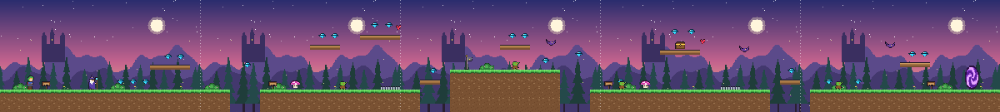
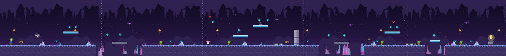

# Las Crónicas de Eldoria: El Cristal del Alba

Videojuego de **plataformas 2D de fantasía** hecho para **GDevelop 5**. Los gráficos en pixel art y los efectos de sonido son originales y se generaron para este proyecto. Las imágenes nuevas de la versión 1.4.1 se crearon con Gemini a partir de especificaciones del equipo, y la música de los niveles es de la biblioteca de GDevelop (uso público). Así no hay problemas de derechos de autor. Ver `NOTA_IA.md`.

## Cómo abrirlo

1. Abre GDevelop 5 (versión 5.6 o superior recomendada).
2. Ve a **Archivo → Abrir proyecto** y elige `game.json`, que está en esta carpeta.
3. Pulsa **Vista previa** (▶). El juego empieza en la escena `Menu`.

> Mantén juntas las carpetas `assets/` y `game.json`, porque el proyecto usa rutas relativas.

## Controles

| Acción | Teclas |
|---|---|
| Moverse | ← → o A / D |
| Saltar (mantener = más alto) | Espacio, ↑ o W |
| Doble salto (con manzana) | Pulsar saltar otra vez en el aire |
| Interactuar / avanzar diálogo | E o Enter |
| Saltar la cinemática | Enter |

---

## 1. Concepto y narrativa

Eldoria vivía en un amanecer eterno gracias al **Cristal del Alba**. Una noche, el **Rey Goblin Morgrak** lo robó y el reino quedó a oscuras. **Lyra**, una joven exploradora élfica del bosque, sale a recuperarlo.

- **Nivel 1, Bosque de Sylvaria:** el Sabio Eldric le encarga la misión. Para cruzar el portal sellado al final del bosque, Lyra necesita la **Llave Rúnica**, que está guardada en un cofre antiguo.
- **Cinemática de transición:** Lyra cruza el portal y llega a las profundidades.
- **Nivel 2, Cavernas de Cristal:** el hada Lumi la guía y la cura. Lyra activa una palanca que abre la compuerta de Morgrak, y en la segunda parte (`Nivel2b`) se enfrenta al **Rey Goblin**, que la persigue a toda velocidad. Cuando lo vence, recupera el Cristal en su altar.
- **Final:** amanece de nuevo sobre Eldoria.

## 2. Estructura de escenas

| Escena | Contenido |
|---|---|
| `Menu` | Título, historia, controles y música del menú |
| `Nivel1` | Bosque de Sylvaria: unas 6 pantallas (≈5900 px) con tramos de ascenso en vertical |
| `Secreto` | Claro escondido: se entra por el árbol hueco sobre la nube del Nivel 1 (hace falta una manzana). 3 pantallas con lago, nenúfares, tesoro y portal de regreso |
| `Transicion` | Animación de unos 14 s entre niveles: fundido, Lyra corre al portal, narración letra a letra, destello y tarjeta del Nivel 2 |
| `Nivel2` | Cavernas de Cristal, parte 1: unas 6 pantallas (≈5750 px), con tramos de ascenso en vertical, hada Lumi y palanca |
| `Nivel2b` | Cavernas de Cristal, parte 2: 5 pantallas (≈4750 px). Aquí está la cámara del jefe final, el **Rey Goblin** |
| `Final` | Pantalla de victoria con el total de gemas |
| `GameOver` | Reintentar el nivel (Enter) o volver al menú (Esc) |

**Extensión del mundo:** el original tenía 2 niveles × 5 pantallas de 960×540 (10 pantallas). La versión 1.4.1 tiene aproximadamente **20 pantallas** de 960×540 entre `Nivel1` (≈6), `Secreto` (3), `Nivel2` (≈6) y `Nivel2b` (5), además de las escenas de menú, cinemática, final y Game Over. Los niveles también crecen en vertical.




> Los mapas de `docs/` corresponden al diseño original (versión 1.0.0).

## 3. Personajes

### Avatar: Lyra
- Usa el comportamiento **Plataformero**: gravedad 1500, salto 720, velocidad 270 y salto sostenido.
- Tiene tres animaciones: `Quieto` (con parpadeo), `Correr` (4 cuadros) y `Saltar`. Se voltea según la dirección.
- Empieza con **3 vidas** y puede llegar a un máximo de **10**. Las vidas son una variable global y se mantienen entre niveles. El HUD muestra el contador como «x N». Al recibir daño queda **1,5 s invulnerable** y parpadea.
- Si cae al vacío, pierde una vida y **reaparece en el último punto de control**.

### NPCs: 4 tipos con comportamientos definidos

| NPC | Tipo | Comportamiento | Reacción de Lyra |
|---|---|---|---|
| **Goblin** | Hostil, terrestre | Patrulla entre `minX` y `maxX`. Si Lyra se acerca a menos de 260 px y a su misma altura, **gruñe, se pone rojizo y la persigue al doble de velocidad** sin salir de su zona. Si ella se aleja, vuelve a patrullar. | Si Lyra **cae sobre él**, el goblin desaparece en una nube de humo y ella rebota. Si lo toca de lado, pierde una vida. |
| **Rey Goblin (jefe final)** | Hostil, terrestre, jefe | Solo aparece en `Nivel2b`. Tiene **4 vidas**. Patrulla ±190 px alrededor de su posición a velocidad 70. Si Lyra se acerca (160 px en horizontal y 90 en vertical), **gruñe, se pone rojizo y la persigue a velocidad 250** (más de tres veces su velocidad de patrulla). Si ella se aleja, vuelve a patrullar. | Cada vez que Lyra **cae sobre él** le quita **1 vida** y el Rey queda 0,9 s inmune, así que hacen falta **4 pisotones**; al cuarto desaparece en una nube de humo. Si lo toca de lado, Lyra pierde una vida. |
| **Murciélago** | Hostil, volador | Vuela de lado a lado **ondulando** sobre su altura base. Si Lyra está a menos de 280 px, **chilla y se lanza en picada** hacia ella. | Igual que con el goblin: se le vence saltando encima. |
| **Sabio Eldric** | Aliado (Nivel 1) | Mira siempre hacia Lyra y muestra el icono **[E]** cuando ella está cerca. Su diálogo **cambia según el progreso**: misión inicial (5 líneas), recordatorio o felicitación si ya tiene la llave. | Activa la misión y muestra el mensaje «Misión: encuentra la Llave Rúnica». |
| **Hada Lumi** | Aliada (Nivel 2) | **Flota** con movimiento senoidal, mira a Lyra y da pistas sobre la palanca. | Al terminar el diálogo **sube las vidas a 4 como mínimo** (si Lyra ya tiene más, las conserva) con efecto de luz y sonido. |

## 4. Interacción con el entorno

| Objeto | Interacción |
|---|---|
| Gemas | Se recogen al tocarlas: destello, sonido y +1 en el contador del HUD |
| Corazones | Dan una vida extra (máximo 10) |
| Gemas (cada 10) | Cada 10 gemas recogidas dan una vida extra, hasta el máximo de 10 |
| Hongo mágico | Si Lyra cae encima, la impulsa muy alto. El hongo se aplasta y suena un «boing» |
| Pinchos | Quitan una vida |
| Bandera | Punto de control: se enciende y guarda la posición de reaparición |
| Carteles | Con **E** muestran consejos o pistas de la historia |
| Cofre antiguo | Con **E** se abre y suelta la **Llave Rúnica**, que aparece en el HUD |
| Portal | Sin la llave muestra un aviso. Con la llave lleva a la cinemática al instante |
| Manzana | Da doble salto durante 30 s (icono y tiempo en el HUD) |
| Agua | Caer al agua quita una vida y reaparece en el punto de control |
| Árbol hueco | Con **E** entra al claro escondido |
| Plataformas móviles | Oscilan en horizontal sobre los abismos y arrastran a Lyra |
| Plataformas en vertical | Plataformas de madera (bosque) y de cristal (cuevas) escalonadas hacia arriba para trepar por zonas altas del nivel |
| Palanca + compuerta | Con **E** se acciona la palanca y la compuerta de piedra se eleva con un estruendo |
| Altar del Cristal | Al tocarlo se gana el juego |

## 5. Sonido

| Tipo | Archivos |
|---|---|
| Música por escena (biblioteca de GDevelop, `assets/*.aac`) | `Menu`: *Action Strike* · `Nivel1`: *Epic Blockbuster 2* · `Nivel2`: *Action Strike* · `Nivel2b` (jefe): *The Enemy* · `Final`: *Beyond - part 2* · `GameOver`: *The Land of the Dead* |
| Música de escenas propias (`assets/audio/`) | `Transicion`: `Musica_escena (mp3cut.net).wav` · `Secreto`: `musica_claro` |
| Ambiente en bucle | `ambiente_bosque` (viento y pájaros), `ambiente_cueva` (zumbido y gotas con eco), `ambiente_claro` (claro escondido) |
| Avatar | `paso` (cada 0,28 s al caminar, con tono aleatorio), `salto`, `doble_salto`, `golpe` |
| NPCs | `goblin` (gruñido de alerta), `murcielago` (chillido), `aplastar`, `dialogo` |
| Entorno | `gema`, `cofre`, `llave`, `hongo`, `checkpoint`, `palanca`, `puerta`, `portal`, `curar`, `cartel`, `seleccionar`, `manzana`, `chapoteo`, `secreto` |

La música suena en el canal 1 y el ambiente en el canal 2. Cada escena detiene los sonidos de la anterior. Los `.wav` de música del proyecto original (`musica_menu`, `musica_bosque`, `musica_cueva`, etc.) siguen en la carpeta pero ya no se usan en las escenas principales.

## 6. Organización de los eventos

Cada escena de nivel agrupa sus eventos por sistema y cada grupo lleva comentarios explicativos:

1. Inicio del nivel: música, ambiente, fundido de entrada y punto de reaparición.
2. Controles del avatar: WASD y tecla de interacción. Los controles se bloquean durante los diálogos.
3. Animación y sonidos del avatar.
4. Cámara y parallax: la cámara sigue a Lyra dentro de los límites del nivel y hay tres capas de fondo.
5. Lógica de los NPCs aliados y su sistema de diálogo.
6. Objetos del entorno (cofre, portal, palanca, plataformas móviles, etc.).
7. Recolectables.
8. NPC Goblin, NPC Murciélago y Rey Goblin (`Para cada objeto`, con variables de instancia). El grupo `Enemigos` reúne a los tres para compartir las reglas de daño.
9. Combate, daño y reaparición.
10. HUD y mensajes.

**Variables globales:** `Vidas`, `Gemas`, `NivelActual`, `TiempoDoble`, `Retorno`, `GLlave`, `GSabio`, `GCofre`, `DecenaVida`.
**Variables de escena:** `Dialogo`, `Accion`, `Danio`, `Pisoton`, `CheckX`, `CheckY`, `Saliendo`, `SaltoExtra`, `TeclaSalto`, y en cada nivel `TieneLlave`/`SabioHablo` o `HadaHablo`/`Abriendo`.
**Variables del Rey Goblin:** `dir`, `vel`, `minX`, `maxX`, `alerta`, `cerca`, `inmune`, `vida` (4).
**Capas:** `Fondo` (parallax), la capa base (juego) y `HUD` (interfaz fija).

## 7. Formato de los recursos gráficos

- Son PNG de 32 bits con **transparencia**, en pixel art a escala ×3: un píxel del dibujo ocupa 3×3 píxeles reales.
- El proyecto usa escalado **nearest** y redondeo de píxeles, y las imágenes tienen el suavizado desactivado para que se vean nítidas.
- Las animaciones están separadas en un archivo por cuadro (`lyra_correr1..4.png`, `portal1..4.png`, etc.), que es el formato que pide GDevelop.
- Los fondos de 960×540 se repiten sin cortes en horizontal (objetos *Tiled Sprite*). Los suelos son texturas *Tiled Sprite* de 48 px de ancho.

## 8. Regenerar o modificar los recursos

En la carpeta `herramientas/` están los scripts de Python que crearon todo. No necesitan librerías externas:

```
python3 herramientas/gen_imagenes.py   # sprites y fondos
python3 herramientas/gen_audio.py      # efectos, ambientes y música
python3 herramientas/gen_proyecto.py   # game.json (escenas, niveles y eventos)
python3 herramientas/gen_mapas.py      # mapas de docs/
```

Ojo: estos scripts corresponden a la versión original (1.0.0). `gen_proyecto.py` **sobrescribe** `game.json`, así que ejecutarlo borraría todos los cambios de la versión 1.4.1, que se hicieron en el editor de GDevelop. No lo ejecutes.

También puedes cambiar cualquier imagen por otra (por ejemplo, de spriters-resource.com) desde el editor de objetos de GDevelop, siempre que mantengas el formato PNG con transparencia.

---

## 9. Cambios respecto al proyecto original

El proyecto original es la versión 1.0.0 (6 escenas) y el modificado es la 1.4.1 (8 escenas). Los cambios se hicieron de forma local en GDevelop, salvo las imágenes nuevas, que se crearon con Gemini (ver `NOTA_IA.md`).

| Área | Original (1.0.0) | Modificado (1.4.1) |
|---|---|---|
| Escenas | `Menu`, `Nivel1`, `Transicion`, `Nivel2`, `Final`, `GameOver` | Se añaden `Secreto` y `Nivel2b` |
| Tamaño de los niveles | 2 niveles de 5 pantallas (4800 px) | `Nivel1` ≈ 6, `Secreto` 3, `Nivel2` ≈ 6 y `Nivel2b` 5 pantallas, con zonas en vertical |
| Vidas | Máximo 3 | Máximo **10**; contador «x N» en el HUD y vida extra cada 10 gemas |
| Plataformas | Plataformas móviles horizontales y suelo a una sola altura | Además, plataformas escalonadas en **vertical** para trepar |
| Jefe final | No había | **Rey Goblin**: 4 vidas, velocidad 250 al perseguir |
| Mecánicas nuevas | — | Manzana con doble salto de 30 s, agua que quita vida, árbol hueco que lleva al claro escondido |
| Música | Ocho pistas `.wav` generadas con script | Pistas de la biblioteca de GDevelop (`.aac`) en menú, niveles, final y Game Over |
| Textos | Textos originales | Diálogos, carteles, mensajes del HUD y del jefe modificados |
| Imágenes | Pixel art generado con script | Se suman imágenes nuevas creadas con Gemini: `Fondo_cinematica2.jpg`, `Imagenes_transicion.jpg`, `Pantalla Final .jpg` y los fondos `F.png` a `F7.png` |
| Variables globales | `Vidas`, `Gemas`, `NivelActual` | Se añaden `TiempoDoble`, `Retorno`, `GLlave`, `GSabio`, `GCofre`, `DecenaVida` |
