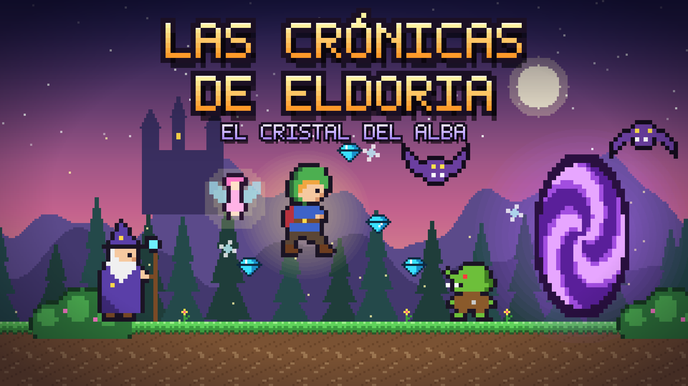

# Las Crónicas de Eldoria: El Cristal del Alba

El Rey Goblin Morgrak ha robado el Cristal del Alba, y el reino de Eldoria ha quedado sumido en una noche eterna. Encarna a Lyra, una joven exploradora élfica, y atraviesa el encantado Bosque de Sylvaria y las misteriosas Cavernas de Cristal para devolver la luz al reino… y enfréntate a Morgrak en persona.

Es un juego de plataformas 2D en pixel art, hecho en **GDevelop 5**. Tiene dos niveles (el segundo dividido en dos partes), un claro escondido y una animación de transición entre ellos. Salta sobre goblins y esquiva murciélagos. Usa hongos mágicos para impulsarte, come manzanas para obtener doble salto, abre cofres, acciona palancas, trepa por plataformas en vertical y cruza portales. Por el camino, el Sabio Eldric te guía y el Hada Lumi cura tus heridas. Al final te espera el **Rey Goblin**, un jefe rápido que te persigue y que cae tras **4 pisotones**.

**Jugar en línea:** [gd.games](https://gd.games/games/6f1d3c2e-8a4b-4f0e-9c1d-e1d0a1a2b3c4)

**Equipo:** Mauricio Campos y Kliment García

**Uso de IA:** ver [NOTA_IA.md](NOTA_IA.md).

## Novedades de esta versión (1.4.1)

Esta versión parte del proyecto original (1.0.0) y añade lo siguiente:

| Área | Cambio |
|---|---|
| Pantallas | Nuevas escenas (`Secreto` y `Nivel2b`) y niveles ampliados en horizontal y en vertical |
| Vidas | Máximo ampliado de 3 a **10** vidas, con contador numérico «x N» en el HUD |
| Plataformas | Tramos de ascenso en **vertical** con plataformas escalonadas |
| Jefe final | **Rey Goblin**: 4 vidas, rápido y persigue a Lyra |
| Música | Pistas propias de la biblioteca de GDevelop en menú, niveles, final y Game Over |
| Textos | Diálogos, carteles, mensajes y créditos modificados |
| Imágenes | Nuevas imágenes de cinemática, transición y pantalla final creadas con Gemini |

El detalle completo está en [LEEME.md](LEEME.md).

## Controles

| Acción | Teclas |
|---|---|
| Moverse | ← → o A / D |
| Saltar (mantener = más alto) | Espacio, ↑ o W |
| Doble salto (con manzana) | Pulsar saltar otra vez en el aire |
| Interactuar / avanzar diálogo | E o Enter |
| Saltar la cinemática | Enter |

## Abrir el proyecto en GDevelop

1. Descarga el repositorio: botón **Code → Download ZIP**, o `git clone`.
2. Abre GDevelop 5 (versión 5.6 o superior).
3. Ve a **Archivo → Abrir proyecto** y elige `game.json`.
4. Pulsa **Vista previa** (▶).

`game.json` y la carpeta `assets/` deben estar juntos.

## Contenido del repositorio

| Ruta | Contenido |
|---|---|
| `game.json` | Proyecto de GDevelop: 8 escenas, objetos, variables y eventos |
| `assets/sprites/` | Gráficos en pixel art (PNG con transparencia) e imágenes de fondo |
| `assets/audio/` | Efectos y ambientes (WAV) y música de cinemática |
| `assets/*.aac` | Música de la biblioteca de GDevelop |
| `assets/portada/` | Portada (1920×1080) e icono (1024×1024) |
| `docs/` | Mapas de los niveles |
| `LEEME.md` | Documento de diseño: historia, personajes, NPCs, interacciones, sonido, eventos y cambios respecto al original |
| `NOTA_IA.md` | Nota sobre el uso de inteligencia artificial en el proyecto |
| `herramientas/` | Scripts de Python de la versión original (gráficos, audio, proyecto, mapas y portada) |

> **Importante:** los cambios de la versión 1.4.1 se hicieron directamente en el editor de GDevelop. Los scripts de `herramientas/` corresponden al proyecto original y, en especial, `gen_proyecto.py` **sobrescribiría** `game.json` y borraría esos cambios. No lo ejecutes.

El documento de diseño completo está en [LEEME.md](LEEME.md).
